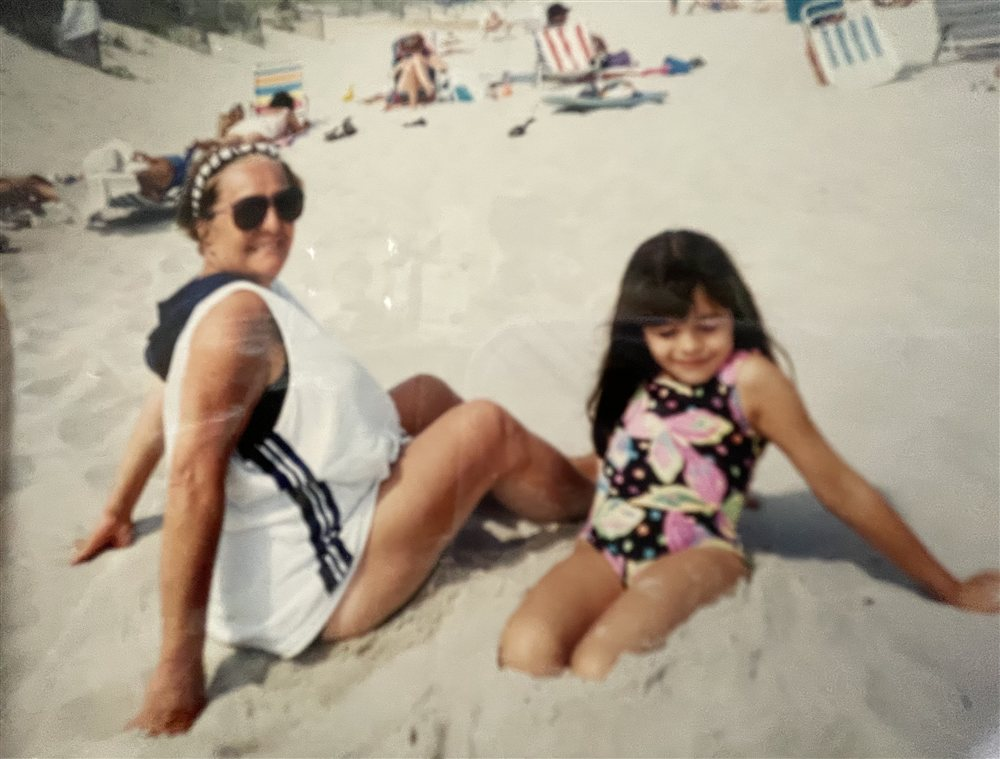
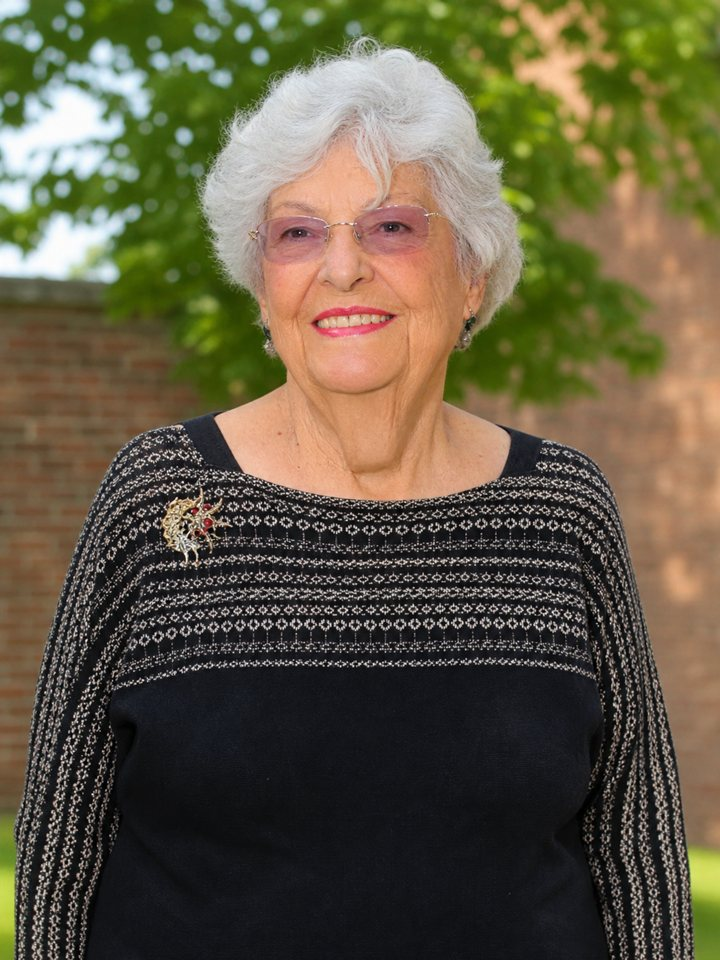
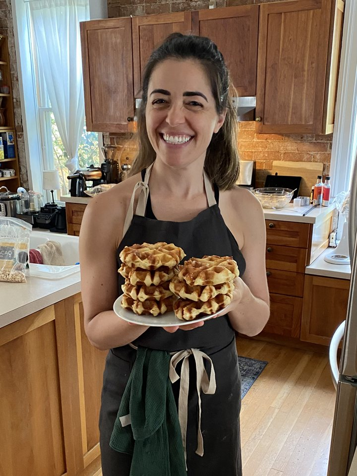

<!-- Hidden page: not linked from the navbar and excluded from site search.
     Recipes live in _recipes/yiayia.yml and _recipes/recipes.yml; see those
     files for how to rebuild. -->

::: {.rc-intro}
{.rc-portrait .rc-photo-wide fig-alt="My yiayia and me as a little girl, sitting in the sand on a crowded beach. She wears sunglasses, a patterned headband, and a white sleeveless top; I'm in a colorful swimsuit."}

Like many, I learned to cook from my grandmother. But, unlike many, I learned from my *yiayia* (γιαγιά, Greek for grandmother). When I think of my yiayia, Mary, I picture her in the kitchen. She didn't cook just because people needed feeding (although I'm sure that gave her a lot of joy). I think she loved the kitchen because it was her craft, the place where she had the most freedom to create.

She was born in the 1920s, the second of five children of parents who had immigrated from Greece. I often wonder what it was like to be a child then, trying to find your place in a world that was so foreign to your parents. We learn so much from our parents without realizing it, and she learned the art of cooking from her mother. I have plenty of stories from that kitchen, and a green tin recipe box full of recipes written in Greek. I imagine she was lucky to discover a craft: partly passed down through tradition, partly because she was the eldest girl, and partly because she had a gift for hospitality.

{.rc-portrait .rc-portrait-left .rc-photo-small fig-alt="My yiayia, Mary, smiling outdoors in front of a brick wall and a leafy tree. She has short white hair and lavender-tinted glasses, and wears a black patterned sweater with a gold brooch."}

These recipes come from her collection. Some are her own, and some came from the friends and family she cooked with: Ero's kourabiedes, Vivian's pumpkin pie, RoseAnn's cheesecake, and a pie crust from Mrs. Myer's mother in Tilson, New York.

Like the ones in that green tin box, a lot of the recipes passed down to me call for things like "a dash of ouzo" or "a couple of spoonfuls of sugar." So I'm working through each of her recipes to give more precise measurements, because not everyone has a yiayia on standby. Cooking was something that she freely shared, and I hope to do the same here.

{.rc-portrait fig-alt="Me in my kitchen wearing a dark apron, smiling and holding a plate stacked with golden waffles."}

I'm happy to have found something that I enjoy so much, and I thank my yiayia for all those days in the kitchen when we would create together. I love it when I make something and think, "This tastes like what my yiayia would make."

In these pages, you'll see an assortment of recipes. You can toggle between the ones from my yiayia, and ones I've discovered on my own. Each recipe is marked *Not yet tested* until I've made it myself, so amounts and times may need adjusting. Every one has a printable card you can download.
:::

```{r}
#| output: asis
source("_recipes/recipes.R")
cat(recipe_book_md())
```
