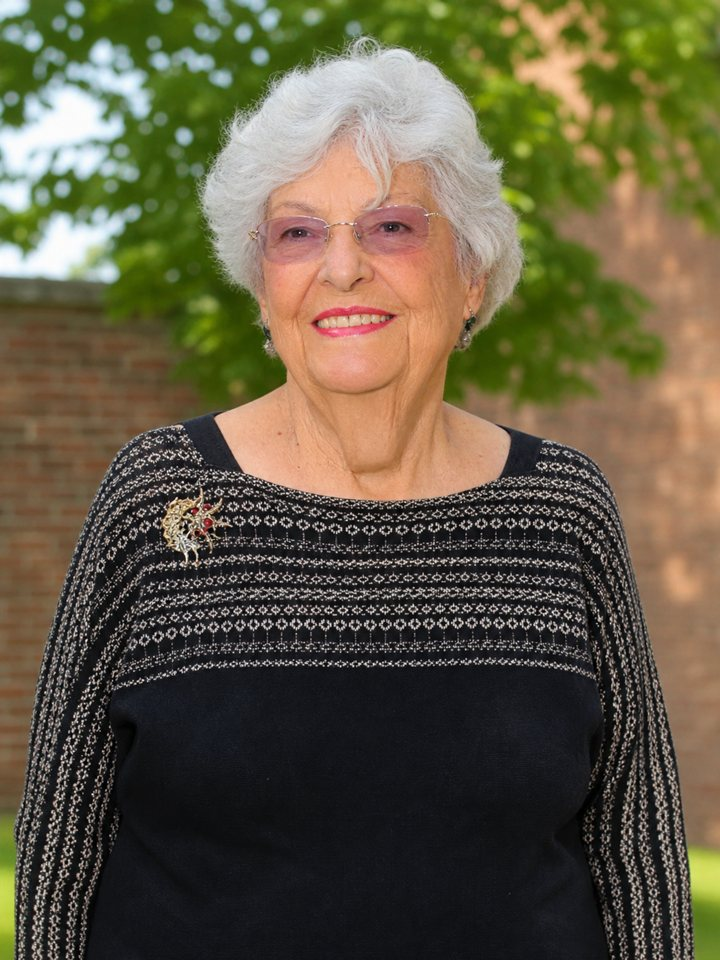

<!-- Hidden page: not linked from the navbar and excluded from site search.
     Recipes live in _recipes/yiayia.yml; see that file for how to rebuild. -->

<!-- To add a photo, save it as images/yiayia.jpg and uncomment the next line:
{.rc-hero-photo fig-alt="DESCRIBE THE PHOTO"}
-->

When I think of my *yiayia* (γιαγιά, Greek for grandmother), Mary, I picture her in the kitchen. She didn't cook just because people needed feeding. I think she loved the kitchen because it was her craft, the place where she had the most freedom to create.

She was born in the 1920s, the second of five children of parents who had immigrated from Greece. I often wonder what it was like to be a child then, trying to find your place in a world that was so foreign to your parents. We learn so much from our parents without realizing it. I imagine she was lucky to discover a craft: partly passed down through tradition, partly because she was the eldest girl, and partly because she had a gift for hospitality.

These recipes come from her collection. Some are her own, and some came from the friends and family she cooked with: Ero's kourabiedes, Vivian's pumpkin pie, RoseAnn's cheesecake, and a pie crust from Mrs. Myer's mother in Tilson, New York.

I love it when I make something and think, "This tastes like what my yiayia would make." I'm still working my way through these. Each recipe is marked *Not yet tested* until I've made it myself, so amounts and times may need adjusting. Every one has a printable card you can download.

```{r}
#| output: asis
source("_recipes/recipes.R")
cat(recipe_page_md(load_recipe_box("_recipes/yiayia.yml")))
```
